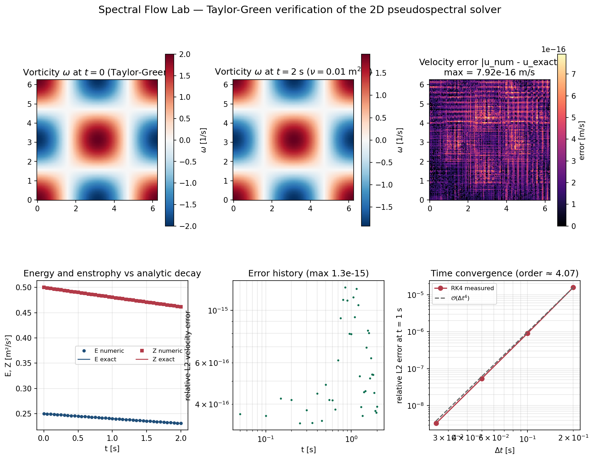

# 🌊 Spectral Flow Lab

**An original 2D incompressible Navier–Stokes solver in vorticity–streamfunction form: FFT operators, strictly de-aliased conservative nonlinear terms, and RK4 time stepping — verified to the machine-precision roundoff floor against the analytic Taylor–Green vortex.**

<div align="center">
  
</div>

<p align="center"><sub>Cover image: computed by <code>examples/run_verification.py</code> (NumPy 2.1.3).
Panels show the initial and t = 2 s vorticity fields, the pointwise velocity error
against the analytic solution, energy/enstrophy against the exact decay, and the
measured RK4 convergence order.</sub></p>

## 🎯 Purpose and scope

A compact, readable, fully verified spectral solver for the periodic 2D
Navier–Stokes equations, intended for learning and for reuse as a trusted
core in coursework or research prototypes. Physical scope: single-phase,
constant-property, incompressible 2D flow on [0, 2π)². Not a turbulence
modeling tool, not 3D, and no experimental validation is claimed.

## 🧮 Model, method, and stability

The vorticity–streamfunction formulation with conservative de-aliased
nonlinear terms:

- ω̂ₜ = −i k·F[u ω] − ν k² ω̂, ψ̂ = ω̂/k² (k ≠ 0), û = i k_y ψ̂, v̂ = −i k_x ψ̂
- De-aliasing: strict retained band |kₓ|, |k_y| < N/3 with input **and**
  output projection — alias-free quadratic products on the retained band
  (an inclusive N/3 boundary would fold boundary pairs back into the band)
- Time stepping: classical RK4; stability rules of thumb
  ν·2(N/2)²·Δt ≲ 2.8 and max|u|Δt/Δx ≲ 1
- Mean vorticity ω̂(0,0) is an exactly conserved passive constant; the
  recovered velocity is the curl-inverse of the zero-mean part of ω
  (a periodic streamfunction cannot represent uniform background curl)

Full derivation with symbols, units, and discretization details:
[docs/model.md](docs/model.md).

## ⚡ Quick start

```bash
python -m pip install -r requirements.txt     # numpy, matplotlib (pinned)
python -m pytest tests -q                     # 12 verification tests
python examples/run_verification.py           # regenerates every figure + CSV
```

Verified runtime: Python 3.13.5, NumPy 2.1.3, Matplotlib 3.10.0, Windows 11
(CI runs the test suite on Ubuntu). Typical cost: tests ≈ 6 s; the full
results script ≈ 1 min at N=128.

## 🧱 Architecture and API

```
spectral_flow/
├── __init__.py      # public exports
└── solver.py        # SpectralVorticitySolver + Taylor-Green references
tests/test_solver.py # 12 verification tests
examples/run_verification.py  # all figures + raw data
docs/model.md  docs/verification.md  docs/results/
```

```python
from spectral_flow import SpectralVorticitySolver, taylor_green_vorticity

solver = SpectralVorticitySolver(n=128, viscosity=0.01)   # domain [0, 2π)²
history = solver.integrate(w0, dt=0.001, nsteps=2000, sample_every=100)
for t, w_hat in history:
    print(t, solver.energy(w_hat), solver.enstrophy(w_hat))
u, v = solver.velocity(history[-1][1])
```

Key API: `integrate(w0, dt, nsteps, sample_every)`, `step_rk4`,
`velocity`/`velocity_hat`, `nonlinear_hat`, `energy`, `enstrophy`,
`velocity_l2_error`.

## 📊 Results and metrics

| Case | Metric | Value |
| --- | --- | --- |
| Taylor–Green, N=128, ν=0.01, t=2 s | relative L2 velocity error | **3.9e-16** (roundoff floor) |
| Taylor–Green, same | energy vs ¼e^{−4νt}, enstrophy vs ½e^{−4νt} | match to 1e-8 relative |
| Nonlinear operator vs 3/2-rule padded reference (N=48) | relative difference | **< 1e-12** |
| RK4 time convergence (N=8, ν=0.5, T=1) | observed order | **4.12 / 4.06 / 4.03** |
| Nonlinear cascade demo (N=128, ν=5e-4, 8 s) | energy nearly conserved, enstrophy decays, spectrum broadens | computed demonstration only |

Raw data and reproduction: [docs/results/](docs/results) —
`taylor_green_history.csv`, `time_convergence.csv`, `nonlinear_history.csv`,
`nonlinear_spectra.csv`, `run_summary.json`; the nonlinear cascade figure is
[docs/results/nonlinear_cascade.png](docs/results/nonlinear_cascade.png).
Flagship preview image: `docs/results/project_preview.png`.

## ✅ Verification

Twelve tests pin every distinct property: Poisson-sign velocity recovery
(1e-12), machine-precision divergence freedom, curl round trip at all
retained modes, the padded-reference alias check, strict mask boundary,
decay accuracy, resolvable RK4 order, mean-vorticity conservation, FD
cross-check, input validation. What each test does and does not establish:
[docs/verification.md](docs/verification.md). Limits: Taylor–Green verifies
the linear machinery exactly; nonlinear correctness comes from the padded
reference; no experimental or turbulence-statistics validation is claimed.

## ⚠️ Limitations and next steps

- Explicit RK4 imposes the usual Δt bounds (documented above); very viscous
  or very fine grids want a semi-implicit viscous term — a natural next step.
- 2D periodic only: no walls, no forcing, no 3D, no variable ν.
- The cascade demo is illustrative (no external reference) — resolution and
  Reynolds sweeps would be needed before drawing physics conclusions.
- Failure handling: constructor validates inputs; the integrator does not
  detect blow-up (watch energy histories when exploring new parameter
  regimes).

## 📚 References

- G. B. Batchelor, *An Introduction to Fluid Dynamics* (Taylor–Green vortex).
- C. Canuto, M. Y. Hussaini, A. Quarteroni, T. A. Zang, *Spectral Methods in
  Fluid Dynamics* (de-aliasing / 2/3 rule, Galerkin truncation).
- NumPy FFT routines (implementation dependency, BSD-licensed).

Software dependencies: NumPy (BSD), Matplotlib (PSF-based license),
pytest (MIT). This repository's own code is original and MIT-licensed; see
[LICENSE](LICENSE).
