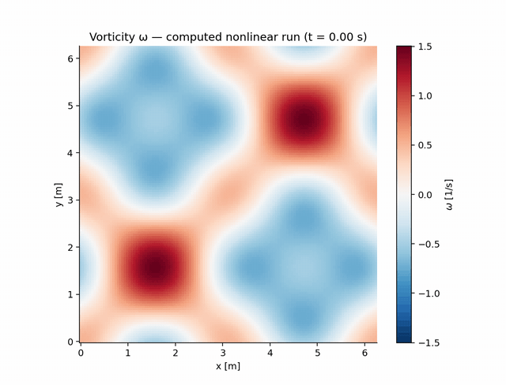

# 🌀 Vortex Notebook

**An executable guide to periodic vortex dynamics: an original 2D incompressible Navier–Stokes spectral solver — strictly de-aliased vorticity–streamfunction formulation with RK4 — delivered as a tested Python package plus a fully executed Jupyter notebook, and verified to the roundoff floor against the analytic Taylor–Green vortex.**

[](https://github.com/khalil-official/vortex-notebook/actions/workflows/ci.yml)
[](LICENSE)
[](requirements.txt)

<div align="center">

**▶ Watch the computed vortex cascade:**



<sub>41 frames recorded from the computed N=128 run (ν = 5e-4 m²/s, 8 s,
seed 20261018) by <code>examples/run_verification.py</code>. Physical
coordinates, fixed color scale, no smoothing — the animation shows exactly
what the solver produced.</sub>

</div>

## 🎯 Purpose and scope

A compact, readable, fully verified spectral solver for the periodic 2D
Navier–Stokes equations, packaged as `spectral_flow` (tested module) and
explored interactively in **[docs/vortex_notebook.ipynb](docs/vortex_notebook.ipynb)**
— an executed notebook containing the derivations, every verification case,
and the parameter playground. Physical scope: single-phase, constant
property, incompressible 2D flow on [0, 2π)². Not a turbulence modeling
tool, not 3D, and no experimental validation is claimed.

## 🧮 Model, method, and stability

Vorticity–streamfunction form with conservative de-aliased nonlinear terms:

- ω̂ₜ = −i k·F[u ω] − ν k² ω̂, ψ̂ = ω̂/k² (k ≠ 0), û = i k_y ψ̂, v̂ = −i k_x ψ̂
- De-aliasing: strict retained band |kₓ|, |k_y| < N/3 with input **and**
  output projection — alias-free quadratic products on the retained band
  (an inclusive N/3 boundary would fold boundary pairs back into the band)
- Time stepping: classical RK4; stability rules of thumb
  ν·2(N/2)²·Δt ≲ 2.8 and max|u|Δt/Δx ≲ 1
- Mean vorticity ω̂(0,0) is an exactly conserved passive constant; the
  recovered velocity is the curl-inverse of the zero-mean part of ω

Full derivation with symbols, units, and discretization details:
[docs/model.md](docs/model.md). Method exposition is also embedded in the
[notebook](docs/vortex_notebook.ipynb).

## ⚡ Quick start

```bash
python -m pip install -r requirements-dev.txt   # numpy, matplotlib, pillow, pytest, jupyter
python -m pytest tests -q                       # 12 verification tests
python examples/run_verification.py             # figures + animation + raw data
python examples/build_notebook.py --execute     # rebuild + re-execute the notebook
```

Verified runtimes: Python 3.13.5, NumPy 2.1.3, Matplotlib 3.10.0, Windows 11
(CI runs the test suite on Ubuntu). Typical cost: tests ≈ 6 s; the full
results script ≈ 1 min at N=128; the notebook ≈ 2 min.

## 🧱 Architecture and API

```
spectral_flow/               # tested solver package
├── solver.py                # SpectralVorticitySolver + Taylor-Green references
docs/
├── vortex_notebook.ipynb    # executed guide: derivations + every case + playground
├── model.md  verification.md
└── results/                 # figures, animation, CSV/JSON from the recorded run
tests/test_solver.py         # 12 verification tests
examples/                    # run_verification.py, build_notebook.py
```

```python
from spectral_flow import SpectralVorticitySolver, taylor_green_vorticity

solver = SpectralVorticitySolver(n=128, viscosity=0.01)   # domain [0, 2π)²
history = solver.integrate(w0, dt=0.001, nsteps=2000, sample_every=100)
for t, w_hat in history:
    print(t, solver.energy(w_hat), solver.enstrophy(w_hat))
u, v = solver.velocity(history[-1][1])
```

Key API: `integrate(w0, dt, nsteps, sample_every)`, `step_rk4`,
`velocity`/`velocity_hat`, `nonlinear_hat`, `energy`, `enstrophy`,
`velocity_l2_error`. With `dealias=True` the spectral-input functions expect
band-limited fields; `integrate` guarantees this (see
[docs/model.md](docs/model.md)).

## 📊 Results and metrics

| Case | Metric | Value |
| --- | --- | --- |
| Taylor–Green, N=128, ν=0.01, t=2 s | relative L2 velocity error | **3.9e-16** (roundoff floor) |
| Taylor–Green, same | normalized energy & enstrophy vs ¼e^{−4νt}, ½e^{−4νt} | match to 1e-8 relative |
| Nonlinear operator vs 3/2-rule padded reference (N=48) | relative difference | **< 1e-12** |
| RK4 time convergence (N=8, ν=0.5, T=1) | observed order | **4.12 / 4.06 / 4.03** |
| Shell statistic Parseval closure (notebook) | \|Σ_k E(k) − E_mean\| / E_mean | ~1e-16 |
| Nonlinear cascade demo (N=128, ν=5e-4, 8 s) | energy nearly conserved, enstrophy decays, spectrum broadens | computed demonstration only |

Raw data and reproduction: [docs/results/](docs/results) —
`taylor_green_history.csv`, `time_convergence.csv`, `nonlinear_history.csv`,
`nonlinear_spectra.csv`, `run_summary.json`; the shell statistic is
**shell-summed** coefficient energy (Σ_k E(k) = mean kinetic energy, by
Parseval). Figures (white background, no grid lines):
[taylor_green_verification.png](docs/results/taylor_green_verification.png)
(cover), [nonlinear_cascade.png](docs/results/nonlinear_cascade.png),
animation [vorticity_evolution.gif](docs/results/vorticity_evolution.gif),
and the 1280×640 social card `docs/results/project_preview.png`.

## ✅ Verification

Twelve tests pin every distinct property: Poisson-sign velocity recovery
(1e-12), machine-precision divergence freedom, curl round trip at all
retained modes, the padded 3/2-rule reference alias check, strict mask
boundary, decay accuracy, resolvable RK4 order, mean-vorticity conservation,
an independent finite-difference cross-check, and input validation. What
each test does and does not establish: [docs/verification.md](docs/verification.md).
Limits: Taylor–Green verifies the linear machinery exactly; nonlinear
correctness comes from the padded reference; no experimental or
turbulence-statistics validation is claimed.

## ⚠️ Limitations and next steps

- Explicit RK4 imposes the usual Δt bounds (documented above); very viscous
  or very fine grids want a semi-implicit viscous term — a natural next step.
- 2D periodic only: no walls, no forcing, no 3D, no variable ν.
- The cascade demo is illustrative (no external reference) — resolution and
  Reynolds sweeps would be needed before drawing physics conclusions.
- Failure handling: the constructor validates inputs; the integrator does
  not detect blow-up (watch energy histories when exploring new regimes).

## 📚 References

- G. B. Batchelor, *An Introduction to Fluid Dynamics* (Taylor–Green vortex).
- C. Canuto, M. Y. Hussaini, A. Quarteroni, T. A. Zang, *Spectral Methods in
  Fluid Dynamics* (de-aliasing / 2/3 rule, Galerkin truncation).
- E. F. Toro, *Riemann Solvers and Numerical Methods for Fluid Dynamics*
  (background on conservative formulations).

Dependencies: NumPy (BSD-3), Matplotlib (PSF-based), Pillow (HPND),
pytest/nbclient/Jupyter (own licenses) — see `requirements*.txt`. This
repository's own code is original and MIT-licensed; see [LICENSE](LICENSE).
